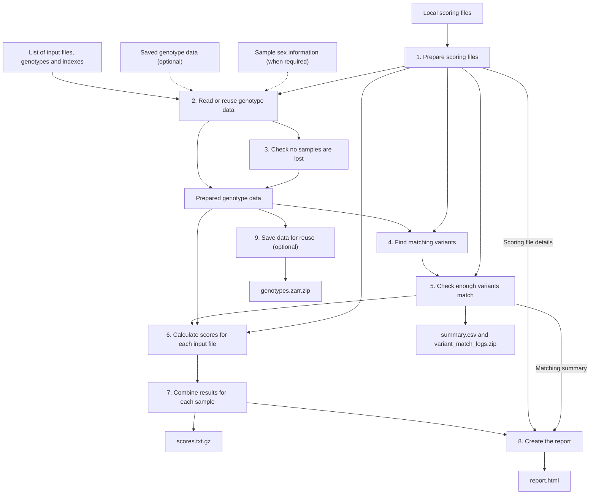

# pgsc_calc v3-alpha.2

Use pgsc_calc to calculate polygenic scores from your genotype data and scoring
files from the [PGS Catalog](https://www.pgscatalog.org/) or your own research.
The Docker image contains the software you need. It runs on one machine and can
calculate scores without an internet connection once you have downloaded the
image and input files.

**This version is still in alpha.** Automated tests pass, but validation with
large datasets and in trusted research environments is still in progress.
Start with a small dataset before using it for a larger analysis.

To try it, [prepare your files](#1-prepare-your-files), [run the Docker command](#2-calculate-your-scores),
then [open the report and check the results](#3-check-your-results).
You do not need to install Nextflow separately: it is included in the image and
manages the calculation steps for you.

## Run with Docker

### 1. Prepare your files

You need Docker and enough memory and disk space for your analysis. Download
all input files before starting the calculation.

Create an `input/` directory containing:

- genotype files in VCF or BGEN format, with an index for each file
- a `.sample` file for each BGEN input, containing its sample information
- scoring files in an `input/scores/` directory
- an `input/samplesheet.csv` file listing the genotype files to use

For VCF, each `.vcf.gz` file needs a `.vcf.gz.csi` index. For BGEN, each `.bgen`
file needs a `.bgen.bgi` index. Indexes let the software find the parts of a file
it needs without reading the whole file.

Use the same genome build for your genotype data and PGS Catalog scoring files:
`GRCh37` or `GRCh38`. A genome build is the reference version used to give genetic
variants their positions. If a custom scoring file uses a different build, you
need extra files to convert those positions. See the [genome-build conversion instructions](docs/docs/howto/offline-v3.md).

#### List your genotype files

Create `input/samplesheet.csv` with one row per genotype file. Use the VCF example
or the BGEN example below, replacing the filenames with your own.

The Docker command in the next section makes your `input/` directory available
as `/input` inside the container. Use `/input/...` paths in the CSV so the
software can find your files there.

For VCF:

```csv
sampleset,chrom,path,file_format,genotyping_method
cohort,1,/input/chr1.vcf.gz,vcf,wgs
cohort,2,/input/chr2.vcf.gz,vcf,wgs
```

For BGEN:

```csv
sampleset,chrom,path,file_format,genotyping_method,bgen_sample_file
cohort,1,/input/chr1.bgen,bgen,array,/input/cohort.sample
cohort,2,/input/chr2.bgen,bgen,array,/input/cohort.sample
```

The column names must stay as shown. Fill them in as follows:

| Column | What to enter |
| --- | --- |
| `sampleset` | A name for the group of samples you are analysing. Use the same name on every row. |
| `chrom` | The chromosome in this file. Leave it empty if the file contains the whole genome. |
| `path` | The genotype file's path inside the container. |
| `file_format` | `vcf` or `bgen`. |
| `genotyping_method` | `array` for genotyping-array data, or `wgs` for whole-genome sequencing data. |
| `bgen_sample_file` | The path to the BGEN sample file. Only needed for BGEN inputs. |

Use one group of samples per run. You can split its files by chromosome or into
batches of samples. If genotype calls were produced independently for different
groups, analyse those groups in separate runs.

When a genotype is missing, the calculation uses variant frequencies estimated
across the sample group. Files that omit a variant to mean that samples have two
copies of the reference allele are not yet supported.

#### Add sample sex information when needed

If any scoring file includes variants on chromosome X or Y, create
`input/sex.tsv`. This must be a tab-separated file with `sample_id` and `sex`
columns. Include every sample and use these values:

- `0` for unknown
- `1` for male
- `2` for female

Add `--sex_map /input/sex.tsv` to the calculation command below.

### 2. Calculate your scores

Download a successfully published [alpha.2 Docker image](https://github.com/PGScatalog/pgsc_calc/actions/workflows/dockerhub.yml),
then run:

```bash
docker pull pgscatalog/pgsc_calc:v3-alpha.2
mkdir -p work results

docker run --rm --network none \
  -v "$PWD/input:/input:ro" \
  -v "$PWD/work:/work" -v "$PWD/results:/results" -w /work \
  pgscatalog/pgsc_calc:v3-alpha.2 \
  pgsc_calc_workflow \
  --input /input/samplesheet.csv \
  --scorefile '/input/scores/*.txt.gz' \
  --target_build GRCh38 --outdir /results
```

Change `--target_build GRCh38` to `--target_build GRCh37` if your genotypes use
GRCh37. The quoted `*.txt.gz` pattern selects the compressed scoring files in
`input/scores/`; change it if your files have different names or extensions.

The command gives the software read-only access to `input/` and saves working
files in `work/` and results in `results/`. Network access is disabled during
the calculation. You cannot use `--pgs_id`, `--pgp_id` or `--efo_id` to download
scores through this launcher; supply the downloaded scoring files instead.

The `v3-alpha.2` image tag is updated as development continues. For repeatable
runs, record and use the image's digest: the fixed identifier for that particular
build.

### 3. Check your results

Wait for the workflow to report that it completed successfully. Then open
`results/report.html` and check the matching results and score distributions.

| Output in `results/` | What it contains |
| --- | --- |
| `scores.txt.gz` | A compressed table of scores for each sample. |
| `report.html` | A report showing how variants matched and how scores vary across samples. |
| `summary.csv` | A summary of variant matching for each score. |
| `variant_match_logs.zip` | Detailed variant-matching results. |
| `genotypes.zarr.zip` | Prepared genotype data saved for use in later runs. Created by default. |
| `sex_check/` | Results of checks involving sample sex, when produced. |

Some output files can appear before the run finishes. Their presence alone does
not mean the run succeeded. The run also fails if it cannot save the genotype
archive when that output is enabled.

To continue an interrupted run, keep `work/`, including its hidden `.nextflow`
directory. Repeat the same Docker command with `-resume` added after the workflow
options. Keeping `results/` alone is not enough to resume.

## What happens during a run

The diagram shows how the steps depend on each other. You run one command;
pgsc_calc manages these steps for you. Arrows show which inputs and results each
step needs. Dashed arrows show optional inputs or inputs needed only in some cases.



The numbered descriptions below follow the diagram. The names in brackets also
appear in the run log. Steps can run at the same time when their inputs are
ready; saving data for reuse does not wait for scoring to finish.

1. **Prepare scoring files (`FORMAT`).** Reads the variants and weights in each
   scoring file and puts them into a common format.
2. **Read or reuse genotype data (`LOAD`).** Reads the data needed for your
   requested scores from each genotype file. Reuses previously saved data where
   possible and reads any extra variant positions needed for new scores.
3. **Check no samples are lost (`CHECK_SAMPLES`).** Checks that ignoring files
   with no relevant variants would not leave any samples out of the results.
   Stops if samples would be lost or no usable genotype data remain.
4. **Find matching variants (`MATCH`).** Compares the variants in your genotype
   data with those in the scoring files, using their positions and DNA changes.
5. **Check enough variants match (`MATCH_COMBINE`).** Brings the matching results
   together and checks whether each score has enough matching variants. Excludes
   scores below your minimum overlap setting and saves the matching logs.
   By default, at least 75% of a score's variants must match your data. Use
   `--min_overlap` to change this threshold.
6. **Calculate scores for each input file (`SCORE`).** Uses the matched variants
   and their weights to calculate each file's contribution to each sample's scores.
7. **Combine results for each sample (`SCORE_COMBINE`).** Brings together the
   contributions from all input files to give each sample's final scores.
8. **Create the report (`REPORT`).** Builds the HTML report from the scores,
   matching results, scoring file details and run settings.
9. **Save data for reuse (`CACHE_PACK`).** Combines the prepared genotype data
   into `genotypes.zarr.zip`. This is called a genotype cache. It is saved by
   default so later runs can reuse it.

## Reuse genotype data for more scores

You can use `genotypes.zarr.zip` from an earlier run to avoid reading the same
genotype data again. Keep the original genotype files, indexes and BGEN sample
files available: the software still checks them and reads any additional
positions needed by new scores.

Create new working and results directories. The following command makes your
previous results available read-only as `/previous` and supplies the saved data
with `--genotype_cache_zip`:

```bash
mkdir -p work-next results-next
docker run --rm --network none \
  -v "$PWD/input:/input:ro" -v "$PWD/results:/previous:ro" \
  -v "$PWD/work-next:/work" -v "$PWD/results-next:/results" -w /work \
  pgscatalog/pgsc_calc:v3-alpha.2 \
  pgsc_calc_workflow \
  --input /input/samplesheet.csv --scorefile '/input/scores/*.txt.gz' \
  --target_build GRCh38 --outdir /results \
  --genotype_cache_zip /previous/genotypes.zarr.zip
```

The updated archive is saved in `results-next/`. The previous archive is left
unchanged. Allow disk space for both archives and temporary files.

Reuse depends on the input files having the expected sizes and modification
times. Preserve timestamps when copying unchanged files. If those checks fail,
or the archive uses an unsupported version, run without `--genotype_cache_zip`
to prepare the data again.

Add `--publish_cache false` if you do not want to save a genotype archive at the
end of a run.

## Run in a trusted research environment

These examples describe possible ways to run pgsc_calc in UK Biobank and
All of Us. They have not yet been validated on those platforms. Start with a
small dataset and a few scores, and keep restricted data and results within
your research workspace.

Use the same image digest for your validation runs. Request enough CPU, memory
and local disk for the whole calculation: all steps run on one machine. To set
resource limits for individual steps, supply a local Nextflow configuration
file using `-c`.

### UK Biobank Research Analysis Platform

Use [Swiss Army Knife with a Docker image](https://documentation.dnanexus.com/user/running-apps-and-workflows/running-apps-and-applets).
If your project restricts internet access, prepare a Linux AMD64 image archive
on a connected machine, then upload it through your project's approved route:

```bash
docker pull --platform linux/amd64 pgscatalog/pgsc_calc:v3-alpha.2
docker image save --platform linux/amd64 \
  -o pgsc_calc-v3-alpha.2.tar pgscatalog/pgsc_calc:v3-alpha.2
dx upload pgsc_calc-v3-alpha.2.tar
```

For a first test using BGEN data from chromosome 22, select your project with
`dx select`. Adjust the project paths below to point to your genotype, index,
sample and scoring files. The command creates the CSV list using the files
available on the machine running the job:

```bash
dx run app-swiss-army-knife \
  -iimage_file=pgsc_calc-v3-alpha.2.tar \
  -iin=inputs/chr22.bgen -iin=inputs/chr22.bgen.bgi \
  -iin=inputs/cohort.sample -iin=inputs/score.txt.gz \
  -icmd='set -e
printf "sampleset,chrom,path,file_format,genotyping_method,bgen_sample_file\ncohort,22,%s/chr22.bgen,bgen,array,%s/cohort.sample\n" "$PWD" "$PWD" > samplesheet.csv
pgsc_calc_workflow --input "$PWD/samplesheet.csv" \
  --scorefile "$PWD/score.txt.gz" --target_build GRCh37 \
  --outdir "$PWD/results"' \
  --destination /pgsc_calc-test/
```

Check the genome build and choose suitable CPU, memory and disk when prompted.
Also check which new files Swiss Army Knife will upload when the job finishes.

This example uses only chromosome 22. Choose a scoring file with enough variants
on that chromosome to meet the minimum overlap setting. For a full analysis,
include all relevant chromosomes.

For repeated large runs, use an applet (a reusable platform app) that saves your
results and genotype archives. It also needs to save the working files if you
want to resume interrupted runs. See [how DNAnexus handles Docker images](https://documentation.dnanexus.com/developer/apps/dependency-management/using-docker-images).

### All of Us Researcher Workbench

Use the workspace's [Cromwell or Nextflow workflow service](https://support.researchallofus.org/hc/en-us/articles/4811899197076-Workflows-in-the-All-of-Us-Researcher-Workbench-Nextflow-and-Cromwell)
to run pgsc_calc as a single job. Nextflow inside the image manages the calculation
steps on that job's machine. Do not start another Docker container inside it.

1. Choose the published `pgscatalog/pgsc_calc:v3-alpha.2` image by its digest and
   request the CPU, memory and disk needed for the whole calculation.
2. List every genotype, index, BGEN sample, scoring and optional sex-information
   file as a job input. This lets the platform copy the files to the machine
   running the job. Create the CSV list using those local paths. The launcher
   does not accept `gs://` paths.
3. Run this command from a directory where the job can write files:

   ```bash
   pgsc_calc_workflow --input "$PWD/samplesheet.csv" \
     --scorefile "$PWD/score.txt.gz" --target_build GRCh38 \
     --outdir "$PWD/results"
   ```

4. List the files in `results/` as job outputs so the platform saves them to your
   workspace storage. Also save the job's `work/` and `.nextflow/` directories if
   you want to resume after the machine running the job has been removed.

This repository does not yet include a tested All of Us submission script.
Follow the platform tutorial to set up the job and file transfers.

## More help

- [Offline settings, Apptainer and local tests](docs/docs/howto/offline-v3.md)
- [Validation results and work still needed before release](docs/v3-alpha2-validation.md)
- [Python tools and libraries used by pgsc_calc](https://github.com/PGScatalog/pygscatalog)

## Cite and acknowledge

Developed by the PGS Catalog team at the University of Cambridge and EMBL-EBI,
with contributions from the Inouye lab and the wider community.

Please cite Lambert, Wingfield *et al.* (2024), [Enhancing the Polygenic Score
Catalog with tools for score calculation and ancestry normalization](https://doi.org/10.1038/s41588-024-01937-x).
The paper describes the published software; this branch contains ongoing v3 work.

Distributed under the [Apache 2.0 licence](LICENSE), with infrastructure derived
from [nf-core](https://nf-co.re). See [additional citations](CITATIONS.md).

Supported by EMBL-EBI, the Baker Institute, the University of Cambridge, Health
Data Research UK and EU Horizon 2020 grant 101016775 (INTERVENE).
