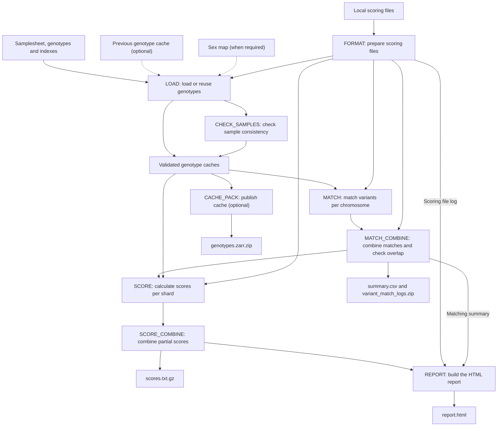

# pgsc_calc v3-alpha.2

Calculate polygenic scores from local [PGS Catalog](https://www.pgscatalog.org/)
or custom scoring files and indexed VCF or BGEN genotypes.

**This is an alpha branch.** Local integration tests pass; large-scale and TRE
validation are still in progress. The image includes Nextflow, the workflow and
its tools. It runs on one machine, with separate tasks for loading, matching and
scoring. You do not need to install Nextflow on the host.

## Workflow overview

This directed acyclic graph (DAG) shows the task dependencies for an offline run.
Loading and scoring run once per genotype shard (an input file); matching groups
the loaded shards by chromosome.



Solid arrows show task dependencies and outputs. Dashed arrows show optional or
conditional inputs. Cache publication runs independently of scoring and is enabled
by default. Reusing a cache loads any additional positions needed by the scores.

## Run with Docker

### 1. Prepare your inputs

Create an `input/` directory containing:

- genotype files and their indexes: `.vcf.gz` with `.vcf.gz.csi`, or `.bgen` with `.bgen.bgi`
- a `.sample` file for each BGEN input
- scoring files in `input/scores/`, downloaded before the run
- `input/samplesheet.csv`, using paths **inside the container**

For VCF, start with:

```csv
sampleset,chrom,path,file_format,genotyping_method
cohort,1,/input/chr1.vcf.gz,vcf,wgs
cohort,2,/input/chr2.vcf.gz,vcf,wgs
```

For BGEN, add the sample-file column:

```csv
sampleset,chrom,path,file_format,genotyping_method,bgen_sample_file
cohort,1,/input/chr1.bgen,bgen,array,/input/cohort.sample
cohort,2,/input/chr2.bgen,bgen,array,/input/cohort.sample
```

Use one sampleset per run. Technical sample batches from the same callset can
share its label; independently called cohorts need separate runs. Leave `chrom`
empty for whole-genome files. Use `array` or `wgs` to describe your inputs.

Missing calls use allele frequencies pooled across the sampleset. Sparse inputs
where an absent variant means a homozygous-reference call are not yet supported.

If any scoring file contains X or Y variants, also supply a tab-separated sex map
with `sample_id` and `sex` columns. Include every sample, using `0` for unknown,
`1` for male and `2` for female. Add `--sex_map /input/sex.tsv` to the command below.

### 2. Run the workflow

Use a successfully published [alpha.2 image build](https://github.com/PGScatalog/pgsc_calc/actions/workflows/dockerhub.yml).
The tag changes as this branch develops. Record its digest for repeatable runs.

```bash
docker pull pgscatalog/pgsc_calc:v3-alpha.2
mkdir -p work results

docker run --rm --network none \
  -v "$PWD/input:/input:ro" \
  -v "$PWD/work:/work" -v "$PWD/results:/results" -w /work \
  pgscatalog/pgsc_calc:v3-alpha.2 \
  pgsc_calc_workflow \
  --input /input/samplesheet.csv \
  --scorefile '/input/scores/*.txt.gz' \
  --target_build GRCh38 --outdir /results
```

Set `--target_build` to your genotype build: `GRCh37` or `GRCh38`. Use matching
Catalog scoring files. Custom scores that need liftover also require local chain
files; see the [offline guide](docs/docs/howto/offline-v3.md).

The run makes no network requests. `--pgs_id`, `--pgp_id` and `--efo_id` downloads
are unavailable through this offline launcher.

### 3. Check and keep the outputs

A successful run writes these files to `results/`:

| File | Contents |
| --- | --- |
| `scores.txt.gz` | Scores for each sample |
| `report.html` | Matching summaries and score distributions |
| `summary.csv` and `variant_match_logs.zip` | Matching results |
| `genotypes.zarr.zip` | Reusable genotype cache, published by default |
| `sex_check/` | Sex-check results, when produced |

Keep `work/`, including its hidden `.nextflow` directory, to resume interrupted
runs. Repeat the same command with `-resume`. Files in `results/` alone do not
mean that the run succeeded: cache publication failure also fails the run.

## Reuse the cache for more scores

Keep the original genotype, index and sample files available. Create new work and
results directories, mount the previous results read-only, and pass the cache:

```bash
mkdir -p work-next results-next
docker run --rm --network none \
  -v "$PWD/input:/input:ro" -v "$PWD/results:/previous:ro" \
  -v "$PWD/work-next:/work" -v "$PWD/results-next:/results" -w /work \
  pgscatalog/pgsc_calc:v3-alpha.2 \
  pgsc_calc_workflow \
  --input /input/samplesheet.csv --scorefile '/input/scores/*.txt.gz' \
  --target_build GRCh38 --outdir /results \
  --genotype_cache_zip /previous/genotypes.zarr.zip
```

Existing genotypes are reused; additional positions are loaded as needed. The
expanded cache goes into `results-next/`, leaving the supplied archive unchanged.
Allow disk space for both archives and temporary files.

Cache reuse checks input sizes and modification times. Preserve timestamps when
copying unchanged inputs. If metadata differs or the cache version is unsupported,
run without `--genotype_cache_zip` to create a new cache. Use
`--publish_cache false` only if you do not want a reusable archive.

## Run in a trusted research environment

Start with a small cohort and a few scores. Use the same image digest for all
validation runs. Allocate CPU, RAM and local disk for the **whole workflow**:
this alpha runs its tasks within one machine, not across cloud workers or cluster
nodes. Supply a local Nextflow configuration with `-c` to set task resources.

The routes below follow platform interfaces but have not yet been validated in
UK Biobank or All of Us. Keep restricted data and outputs within your workspace.

### UK Biobank Research Analysis Platform

Use [Swiss Army Knife with a Docker image](https://documentation.dnanexus.com/user/running-apps-and-workflows/running-apps-and-applets).
For an internet-restricted project, prepare an amd64 image archive on a connected
machine, then upload it through your project's approved route:

```bash
docker pull --platform linux/amd64 pgscatalog/pgsc_calc:v3-alpha.2
docker image save --platform linux/amd64 \
  -o pgsc_calc-v3-alpha.2.tar pgscatalog/pgsc_calc:v3-alpha.2
dx upload pgsc_calc-v3-alpha.2.tar
```

For a first autosomal BGEN test, select your project with `dx select`. Adjust the
project paths below to your genotype, index, sample and scoring files. The command
creates a samplesheet using the files downloaded onto the worker:

```bash
dx run app-swiss-army-knife \
  -iimage_file=pgsc_calc-v3-alpha.2.tar \
  -iin=inputs/chr22.bgen -iin=inputs/chr22.bgen.bgi \
  -iin=inputs/cohort.sample -iin=inputs/score.txt.gz \
  -icmd='set -e
printf "sampleset,chrom,path,file_format,genotyping_method,bgen_sample_file\ncohort,22,%s/chr22.bgen,bgen,array,%s/cohort.sample\n" "$PWD" "$PWD" > samplesheet.csv
pgsc_calc_workflow --input "$PWD/samplesheet.csv" \
  --scorefile "$PWD/score.txt.gz" --target_build GRCh37 \
  --outdir "$PWD/results"' \
  --destination /pgsc_calc-test/
```

Confirm the genome build, select suitable job resources when prompted, and check
which new files Swiss Army Knife will upload. This one-chromosome example needs
scores with sufficient overlap; use all relevant chromosomes for a full analysis.
For repeated large runs, use an applet that explicitly preserves results, cache
archives and any work files needed for resume. See
[DNAnexus Docker image handling](https://documentation.dnanexus.com/developer/apps/dependency-management/using-docker-images).

### All of Us Researcher Workbench

Use the workspace's [Cromwell or Nextflow batch workflow interface](https://support.researchallofus.org/hc/en-us/articles/4811899197076-Workflows-in-the-All-of-Us-Researcher-Workbench-Nextflow-and-Cromwell)
to run the image as **one outer task**. The bundled Nextflow runs locally inside
that task; do not start another Docker container inside it.

1. Set the outer task's container to the published `pgscatalog/pgsc_calc:v3-alpha.2`
   digest and allocate its CPU, RAM and disk.
2. Declare every genotype, index, sample, scoring and optional sex-map file as a
   task input so the platform downloads it to the worker. Create the samplesheet
   using those local paths; the bundled launcher rejects `gs://` paths.
3. In the task's writable working directory, invoke:

   ```bash
   pgsc_calc_workflow --input "$PWD/samplesheet.csv" \
     --scorefile "$PWD/score.txt.gz" --target_build GRCh38 \
     --outdir "$PWD/results"
   ```

4. Declare the files in `results/` as outer-task outputs so the platform saves
   them to the workspace bucket. Preserve Nextflow work and state separately if
   you need resume after the worker is removed.

This repository does not yet provide a tested All of Us submission wrapper.
Use the platform tutorial to configure the outer task and file transfers.

## Further guidance

- [Offline configuration, Apptainer and local tests](docs/docs/howto/offline-v3.md)
- [Validation evidence and remaining release work](docs/v3-alpha2-validation.md)
- [Python tools and libraries](https://github.com/PGScatalog/pygscatalog)

## Cite and acknowledge

Developed by the PGS Catalog team at the University of Cambridge and EMBL-EBI,
with contributions from the Inouye lab and the wider community.

Please cite Lambert, Wingfield *et al.* (2024), [Enhancing the Polygenic Score
Catalog with tools for score calculation and ancestry normalization](https://doi.org/10.1038/s41588-024-01937-x).
The paper describes the published software; this branch contains ongoing v3 work.

Distributed under the [Apache 2.0 licence](LICENSE), with infrastructure derived
from [nf-core](https://nf-co.re). See [additional citations](CITATIONS.md).

Supported by EMBL-EBI, the Baker Institute, the University of Cambridge, Health
Data Research UK and EU Horizon 2020 grant 101016775 (INTERVENE).
